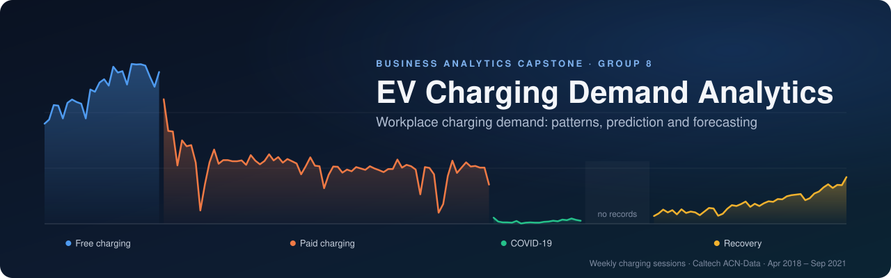
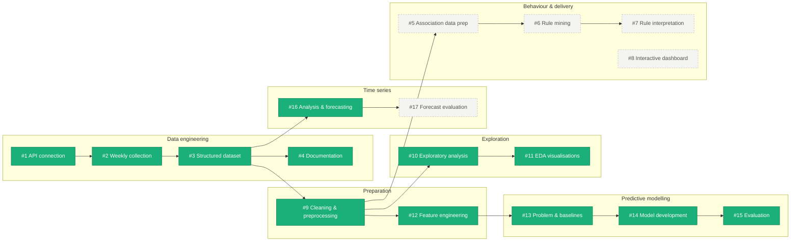
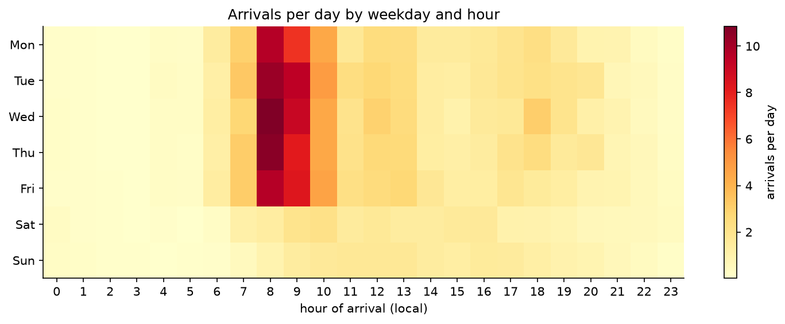
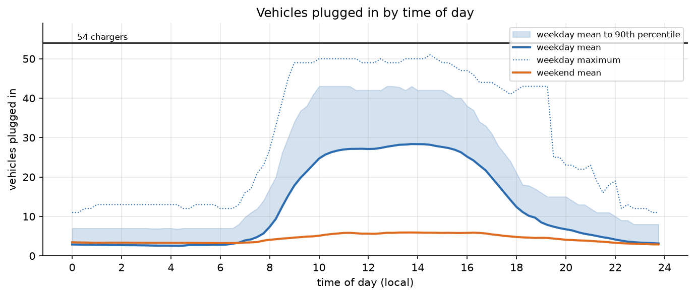
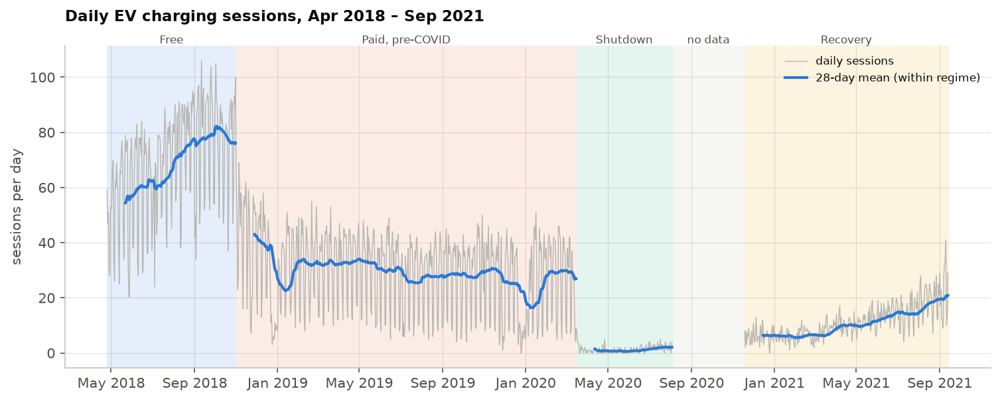
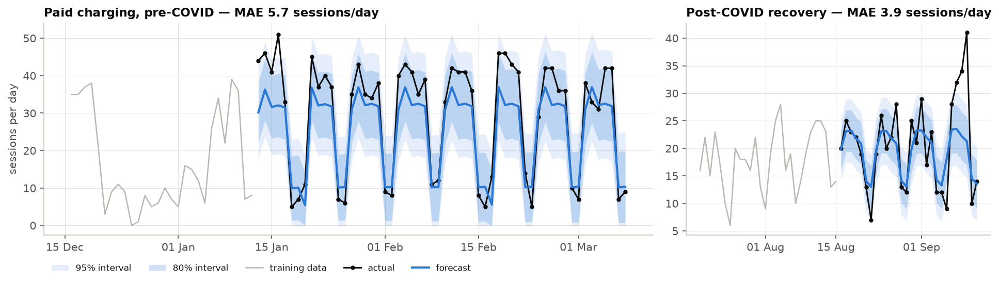
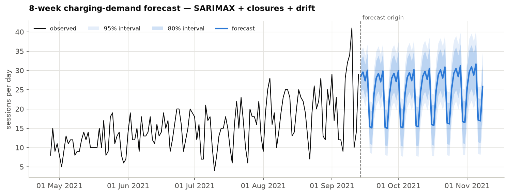
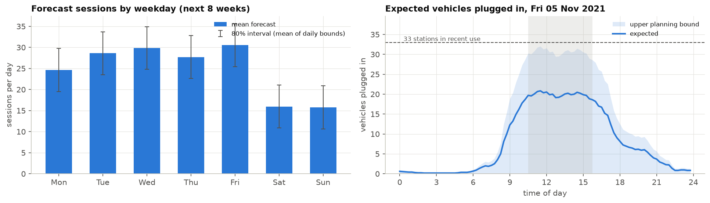

<div align="center">



<br>

**An end-to-end business analytics study of workplace EV charging: from raw API data to demand patterns, predictive models and capacity forecasts.**

<br>

[](https://www.python.org/)
[](notebooks/)
[](https://pandas.pydata.org/)
[](https://scikit-learn.org/)
[](https://www.statsmodels.org/)
[](https://ev.caltech.edu/)
<br>
[](https://github.com/M-Chandana/EV-Charging-Demand-Analytics/commits/main)
[](https://github.com/M-Chandana/EV-Charging-Demand-Analytics/issues)
[](https://github.com/M-Chandana/EV-Charging-Demand-Analytics/issues?q=is%3Aissue+is%3Aclosed)

[Overview](#-overview) •
[Key findings](#-key-findings) •
[Data](#-data) •
[Pipeline](#-analytics-pipeline) •
[Results](#-results) •
[Getting started](#-getting-started) •
[Repository](#-repository-structure) •
[Roadmap](#-roadmap) •
[Team](#-team)

</div>

---

## 📌 Overview

Workplace chargers are expensive to install and easy to get wrong: too few and employees queue, too many and capital sits idle. This project, the **Business Analytics capstone of Group 8**, studies how EV charging demand actually behaves at a real workplace site and turns that into evidence for capacity planning and peak management.

We work with **31,424 charging sessions** recorded at **55 Level-2 stations** on the Caltech campus between **April 2018 and September 2021**, collected from the public [ACN-Data](https://ev.caltech.edu/) API. The period covers three natural experiments that make the data unusually informative: a switch from **free to paid charging** (1 Nov 2018), the **COVID-19 campus shutdown** (March 2020), and the **post-pandemic recovery**.

**Business questions**

| | Question | Where it is answered |
|---|---|---|
| 1 | When do employees charge, and how close does the site come to capacity? | [EDA](#exploratory-analysis-issues-10--11) |
| 2 | How many sessions should we expect tomorrow? | [Predictive modelling](#predictive-modelling-issues-13--15) |
| 3 | How will demand evolve over the coming weeks, and when are the peaks? | [Time-series forecasting](#time-series-analysis-and-forecasting-issue-16) |
| 4 | Which charging behaviours occur together? | [Association rules](#-roadmap) (in progress) |

---

## ✨ Key findings

<table>
<tr>
<td width="25%" align="center"><h3>−51%</h3><sub>typical weekday demand after charging became paid (80 → 39 sessions/day)</sub></td>
<td width="25%" align="center"><h3>94%</h3><sub>of chargers occupied at the busiest moment under free charging (51 of 54)</sub></td>
<td width="25%" align="center"><h3>08:00</h3><sub>peak arrival hour, while plugged-in vehicles peak hours later (11:00–14:00)</sub></td>
<td width="25%" align="center"><h3>35%</h3><sub>lower forecast error than a weekday-average baseline (28-day horizon)</sub></td>
</tr>
</table>

- **Pricing moved demand more than any calendar effect.** Paid charging halved weekday demand and eliminated near-capacity days: 46% of weekdays reached 80% occupancy under free charging, none did afterwards.
- **Capacity is an afternoon problem, not a morning one.** Arrivals bunch at 08:00–10:00, but vehicles stay plugged in long after charging (idle time was 44% of plugged-in hours in 2018), so occupancy peaks between late morning and mid-afternoon.
- **The weekly cycle dominates.** Weekends carry 30–64% of a weekday's demand depending on the regime; annual seasonality is weak (summer about 10% lower).
- **Campus closures are the largest predictable effect.** Closure days lose 44% to 100% of normal demand (Christmas Day: none at all), but Columbus Day, Veterans Day and Juneteenth are normal working days at this site, so the holiday calendar was derived from the data rather than assumed.
- **The 13–14 kWh spike is a policy artefact.** In 2018, 14% of sessions delivered almost exactly 13–14 kWh, consistent with the default energy allowance for unclaimed sessions documented by the dataset authors.
- **Forecast for autumn 2021:** about 28 sessions per typical weekday and an expected peak of 21 vehicles at once. The upper planning bound (32) is close to the 33 stations in recent use, so idle stations should return to service before demand reaches pre-COVID levels.

> Full write-ups: [`eda_key_findings.md`](eda_key_findings.md) · [`preprocessing_report.md`](preprocessing_report.md) · [`time_series_findings.md`](time_series_findings.md)

---

## 🗂 Data

| | |
|---|---|
| **Source** | [ACN-Data](https://ev.caltech.edu/), Adaptive Charging Network, California Institute of Technology |
| **Endpoint** | `https://ev.caltech.edu/api/v1/sessions/caltech` (token authentication) |
| **Coverage** | 25 Apr 2018 – 13 Sep 2021 (1,238 calendar days) |
| **Volume** | 31,424 sessions · 55 stations · 571 registered users · ≈290 MWh delivered |
| **Grain** | One row per charging session (plug-in to unplug) |
| **Collection** | Weekly time windows with retry and back-off, resumable ([Issue #2](notebooks/EV_Charging_Demand_Analysis_i2.ipynb)); every week is cached in [`acn_windows/`](acn_windows/) |

<details>
<summary><b>Session fields (13)</b></summary>

<br>

| Field | Description |
|---|---|
| `_id` | Unique API record identifier |
| `sessionID` | Identifier of the charging session |
| `userID` | Registered user, when the session was claimed in the app |
| `stationID` / `spaceID` | Charging station and parking space |
| `siteID` / `clusterID` | Site and cluster (constant: one site) |
| `connectionTime` | Vehicle plugged in (UTC) |
| `disconnectTime` | Vehicle unplugged (UTC) |
| `doneChargingTime` | Energy delivery finished, when available (UTC) |
| `kWhDelivered` | Energy delivered in the session |
| `timezone` | Site time zone (`America/Los_Angeles`) |
| `userInputs` | Driver-entered requested energy and departure time, when available |

</details>

**Demand regimes.** The series contains structural breaks, confirmed by changepoint detection, so every analysis and model is run per regime:

| Regime | Period | Typical weekday sessions | What changed |
|---|---|---:|---|
| 🔵 Free charging | Apr 2018 – Oct 2018 | 80 | — |
| 🟠 Paid charging | Nov 2018 – mid-Mar 2020 | 39 | $0.12/kWh tariff from 1 Nov 2018 |
| 🟢 COVID-19 shutdown | mid-Mar 2020 – Aug 2020 | 1 | campus closed |
| ⚪ No records | Aug 2020 – Nov 2020 | — | 106 days without any sessions (treated as missing) |
| 🟡 Recovery | Nov 2020 – Sep 2021 | 13, rising 3.6% per week | return to campus |

> [!IMPORTANT]
> **Data coverage of the notebooks.** The first collection run stopped on server errors after 14,400 sessions, and Issues #9–#15 were built on that partial download (Apr–Nov 2018, cleaned to 14,279 sessions). The collection was later completed. Issue #16 rebuilds its series from the full collection with the Issue #9 cleaning rules and reproduces the earlier file exactly on the overlapping window. Re-running Issue #9 on the full collection will bring Issues #10–#15 up to date.

---

## 🔄 Analytics pipeline

Each GitHub issue is one stage, with one notebook and its own outputs.



<sub>Green = complete · dashed = open</sub>

---

## 📊 Results

### Exploratory analysis (Issues #10 – #11)

<table>
<tr>
<td width="50%"></td>
<td width="50%"></td>
</tr>
<tr>
<td><sub>Arrivals concentrate at 08:00–09:00 on weekdays.</sub></td>
<td><sub>Weekday occupancy plateaus from 10:00 to 16:00 and reached 51 of 54 chargers.</sub></td>
</tr>
</table>

Free-charging period (Apr–Nov 2018): 65.5 sessions per day (74.9 on weekdays, 41.9 at weekends), median 7.5 kWh and 4.7 hours per session; the busiest 10 stations carry 34% of sessions. 34 tables and 12 figures in [`eda_tables/`](eda_tables/) and [`eda_figures/`](eda_figures/).

### Feature engineering (Issue #12)

[`feature_engineering.py`](feature_engineering.py) builds a session-level table (time, duration, energy, station-usage and behaviour features) and a daily table with **leakage-safe lag and rolling features** (shifted before aggregation). All checks are recorded in [`feature_validation_summary.csv`](feature_validation_summary.csv).

### Predictive modelling (Issues #13 – #15)

**Target:** daily session count, next-day horizon. **Features:** calendar fields and lagged demand. **Validation:** chronological 80/20 split with `TimeSeriesSplit` tuning (no shuffling).

| Model | Test MAE | RMSE | R² |
|---|---:|---:|---:|
| **Gradient Boosting** | **17.5** | **22.3** | **0.20** |
| Random Forest | 17.7 | 22.3 | 0.20 |
| ElasticNet | 18.8 | 23.5 | 0.11 |
| Baseline: day-of-week mean | 19.9 | 24.7 | 0.01 |
| Baseline: global mean | 23.5 | 28.1 | −0.27 |

The test window (16 Oct – 28 Nov 2018) straddles the switch to paid charging, which no feature can anticipate. This explains the modest R² and motivated the regime-aware approach of Issue #16. Full comparison in [`model_comparison.csv`](model_comparison.csv) and [`evaluation_metrics_i15.csv`](evaluation_metrics_i15.csv); trained models in [`models/`](models/).

### Time-series analysis and forecasting (Issue #16)



**Method selection.** Six approaches were compared on 28-day-ahead forecasts from 28 rolling origins, each fitted only within its own regime:

| Approach | MAE, paid regime | MAE, recovery regime |
|---|---:|---:|
| Seasonal naive (same weekday last week) | 7.97 | 3.81 |
| 8-week weekday mean | 6.82 | 3.86 |
| Holt-Winters, damped trend | 7.67 | 3.55 |
| SARIMA, weekly | 6.21 | 3.47 |
| **SARIMAX + campus closures** | **4.45** | 3.45 |
| **SARIMAX + campus closures + drift** | 4.94 | **3.18** |

The selected model, **SARIMA(1,0,1)×(0,1,1)₇ with a campus-closure regressor and drift**, was refitted on the recovery regime. It leaves no residual autocorrelation (Ljung-Box p = 0.91 at lag 7) and forecasts 8 weeks ahead with 80% and 95% intervals.

<table>
<tr>
<td width="50%"></td>
<td width="50%"></td>
</tr>
<tr>
<td><sub>Held-out weeks: MAE 5.7 (8 weeks before the shutdown) and 3.9 (last 4 weeks of data).</sub></td>
<td><sub>Forecast for 14 Sep – 8 Nov 2021 with 80% and 95% intervals.</sub></td>
</tr>
</table>



> [!NOTE]
> While demand is still growing, the 80% interval covered only about 65% of days in back-testing, and forecasts ran 1.5 sessions/day low on average. Use the 95% band as the planning range. Detailed evaluation is Issue #17.

---

## 🚀 Getting started

### Prerequisites

- Python 3.11 (tested with 3.11.9)
- Jupyter Notebook or JupyterLab
- An ACN-Data API token, *only* if you want to re-download the raw data. All datasets are already in the repository.

### Installation

```bash
git clone https://github.com/M-Chandana/EV-Charging-Demand-Analytics.git
cd EV-Charging-Demand-Analytics

python -m venv .venv
source .venv/bin/activate          # Windows: .venv\Scripts\activate

pip install pandas numpy scipy matplotlib seaborn scikit-learn statsmodels joblib requests jupyter
```

### Running the notebooks

Notebooks are named `notebooks/EV_Charging_Demand_Analysis_i<issue>.ipynb` and run in issue order. Launch Jupyter from the `notebooks/` folder:

```bash
cd notebooks
jupyter lab
```

| Step | Notebook | Reads | Writes |
|---|---|---|---|
| 1–3 | [`i1`](notebooks/EV_Charging_Demand_Analysis_i1.ipynb) · [`i2`](notebooks/EV_Charging_Demand_Analysis_i2.ipynb) · [`i3`](notebooks/EV_Charging_Demand_Analysis_i3.ipynb) | ACN API (token prompted with `getpass`, never stored) | `acn_raw_sessions.csv`, `collection_log.csv`, `acn_structured_sessions.csv` |
| 9 | [`i9`](notebooks/EV_Charging_Demand_Analysis_i9.ipynb) | `acn_structured_sessions.csv` | `acn_clean_sessions.csv`, `acn_flagged_sessions.csv`, `preprocessing_report.md` |
| 10–11 | [`i10`](notebooks/EV_Charging_Demand_Analysis_i10.ipynb) · [`i11`](notebooks/EV_Charging_Demand_Analysis_i11.ipynb) | `acn_clean_sessions.csv` | `eda_tables/`, `eda_figures/`, `eda_key_findings.md` |
| 12 | [`i12`](notebooks/EV_Charging_Demand_Analysis_i12.ipynb) or `python feature_engineering.py` | `acn_clean_sessions.csv` | `feature_engineered_*.csv` |
| 13–15 | [`i13`](notebooks/EV_Charging_Demand_Analysis_i13.ipynb) · [`i14`](notebooks/EV_Charging_Demand_Analysis_i14.ipynb) · [`i15`](notebooks/EV_Charging_Demand_Analysis_i15.ipynb) | `acn_clean_sessions.csv` | `modelling_dataset.csv`, `train_set.csv`, `test_set.csv`, `models/*.joblib`, metric tables |
| 16 | [`i16`](notebooks/EV_Charging_Demand_Analysis_i16.ipynb) | `acn_structured_sessions.csv` | `time_series_*.csv`, `ts_figures/`, `ts_tables/`, `forecast_*_i16.csv`, `models/sarimax_daily_sessions_i16.joblib` |

> [!TIP]
> Notebooks #2, #9, #10 and #11 save their outputs to the current working directory, while the committed copies live at the repository root. After re-running one of them from `notebooks/`, move its outputs up one level before running the next stage. Notebooks #12–#16 locate the repository root automatically.

### Using the forecasting model

```python
import joblib
import pandas as pd
from statsmodels.tsa.statespace.sarimax import SARIMAX

a = joblib.load("models/sarimax_daily_sessions_i16.joblib")
model = SARIMAX(a["endog"], exog=a["exog"], order=a["order"],
                seasonal_order=a["seasonal_order"], trend=a["trend"])
res = model.filter(a["params"])          # fitted model, no re-estimation

# next 7 days, none of them a campus closure
future = pd.date_range(a["endog"].index[-1] + pd.Timedelta(days=1), periods=7, freq="D")
fc = res.get_forecast(7, exog=pd.DataFrame({"campus_closure": 0.0}, index=future))
print(fc.summary_frame(alpha=0.2).clip(lower=0))
```

---

## 📁 Repository structure

```text
EV-Charging-Demand-Analytics/
├── notebooks/                          # one notebook per issue (i1–i3, i9–i16)
├── acn_windows/                        # cached weekly API responses (178 weeks)
├── models/                             # trained models (scikit-learn, SARIMAX)
├── eda_figures/  eda_tables/           # Issue #10–#11 outputs
├── ts_figures/   ts_tables/            # Issue #16 outputs
├── assets/                             # README banner
│
├── acn_raw_sessions.csv                # raw API export          (Issue #2)
├── collection_log.csv                  # sessions per weekly window
├── acn_structured_sessions.csv         # structured dataset      (Issue #3)
├── acn_clean_sessions.csv              # cleaned sessions        (Issue #9)
├── acn_flagged_sessions.csv            # removed rows with reasons
├── feature_engineered_sessions.csv     # session features        (Issue #12)
├── feature_engineered_daily.csv        # daily features
├── feature_engineering.py              # feature pipeline
├── modelling_dataset.csv               # daily modelling table   (Issue #13)
├── train_set.csv  test_set.csv         # chronological split
├── model_comparison.csv                # model benchmark         (Issue #14)
├── evaluation_metrics_i15.csv          # evaluation              (Issue #15)
├── time_series_daily.csv               # prepared daily series   (Issue #16)
├── time_series_hourly.csv              # hourly arrivals & occupancy
├── forecast_daily_i16.csv              # 8-week forecast with intervals
├── forecast_holdout_i16.csv            # actual vs forecast (for Issue #17)
├── ts_backtest_i16.csv                 # rolling-origin comparison
│
├── EV_Workplace_Charging_Dataset_Documentation.docx   # Issue #4
├── structuring_summary.md  preprocessing_report.md
├── eda_key_findings.md  feature_engineering.md  time_series_findings.md
└── README.md
```

---

## 🧭 Roadmap

- [x] ACN-Data API connection, collection and structured dataset (#1 – #4)
- [x] Cleaning and preprocessing (#9)
- [x] Exploratory analysis and visualisations (#10 – #11)
- [x] Feature engineering (#12)
- [x] Predictive modelling and evaluation (#13 – #15)
- [x] Time-series analysis and forecasting (#16)
- [ ] Time-series forecast evaluation (#17)
- [ ] Association rule mining for charging behaviour (#5 – #7)
- [ ] Interactive EV charging analytics dashboard (#8)
- [ ] Re-run Issues #9 – #15 on the complete 2018 – 2021 collection

---

## ⚠️ Limitations

- **Single site.** One campus with 54–55 stations; patterns may not transfer to other workplaces.
- **Short regimes.** No demand regime spans two full years, so annual seasonality is described but not modelled.
- **Missing period.** No sessions were recorded between Aug and Nov 2020; whether the chargers were closed is unknown.
- **Partial user data.** Only sessions claimed in the app carry a `userID` or user inputs (about 1% in mid-2018, 80–97% per quarter from 2019), so driver-level analysis across the policy change is limited.
- **Derived timings.** `doneChargingTime` is missing or inconsistent for a small share of sessions, which affects idle-time and power estimates.

---

## 👥 Team

**Group 8**, Business Analytics capstone.

| Member | Workstream | Issues |
|---|---|---|
| [@M-Chandana](https://github.com/M-Chandana) | Data engineering: API connection, collection, structuring, documentation | #1 – #4 |
| [@ADITHYARAMAN7](https://github.com/ADITHYARAMAN7) | Data preparation and exploration: cleaning, EDA, visualisation, feature engineering, time-series forecasting | #9 – #12, #16 |
| [@bhuvi-d](https://github.com/bhuvi-d) | Predictive analytics: problem definition, modelling, evaluation, forecast evaluation | #13 – #15, #17 |
| [@Gnanesh-12](https://github.com/Gnanesh-12) | Behaviour analytics and delivery: association rules, dashboard | #5 – #8 |

---

## 📚 Citation and acknowledgements

The charging data comes from the **Adaptive Charging Network (ACN-Data)** at Caltech. If you use this work, please cite the dataset:

```bibtex
@inproceedings{lee2019acndata,
  title     = {ACN-Data: Analysis and Applications of an Open EV Charging Dataset},
  author    = {Lee, Zachary J. and Li, Tongxin and Low, Steven H.},
  booktitle = {Proceedings of the Tenth ACM International Conference on Future Energy Systems (e-Energy '19)},
  pages     = {139--149},
  year      = {2019},
  doi       = {10.1145/3307772.3328313}
}
```

Thanks to the ACN team at Caltech for making the data openly available.

## 📄 License

No license has been chosen for this repository yet, so all rights are reserved by the authors until one is added. The ACN-Data dataset is subject to the terms of use published on the [ACN-Data website](https://ev.caltech.edu/).

<div align="center">
<br>
<sub>Built with pandas, scikit-learn and statsmodels · Data: Caltech ACN-Data · Group 8</sub>
</div>
